

## InSAR.dev—Python Ecosystem for Interferometric Synthetic Aperture Radar

InSAR.dev is under active development—new features (and occasionally bugs) are added frequently. Please pin your library versions to ensure reproducibility. When something changes, check the published live examples, which are updated alongside library changes.

The previous-generation [PyGMTSAR](https://github.com/AlexeyPechnikov/pygmtsar) library is production-ready but requires GMTSAR binaries, supports only Sentinel-1, and has fewer processing capabilities.

## Components

| Package | Description | License |
|---------|-------------|---------|
| [insardev](./insardev/) | Core interferometric processing and analysis | InSARdev-SAL-1.0 |
| [insardev_pygmtsar](./insardev_pygmtsar/) | Sentinel-1 and NISAR SLC preprocessing | BSD 3-Clause |
| [insardev_toolkit](./insardev_toolkit/) | Utility functions and helper tools | BSD 3-Clause |

For funded academic, institutional, or professional use of the insardev package, see [insardev/SUBSCRIBE](https://github.com/AlexeyPechnikov/InSARdev/blob/main/insardev/SUBSCRIBE). The BSD-licensed insardev_pygmtsar and insardev_toolkit do not require subscription.

## API Services

The Cache APIs at insar.dev provide fast access to Sentinel-1 data via NASA ASF and Copernicus, and NASA NISAR data. Free for non-commercial use; license required for funded academic, institutional, or professional use. See [insardev/LICENSE](./insardev/LICENSE) for terms.

## Features

- **Per-burst/swath processing** — each Sentinel-1 TOPS burst and NISAR swaths processed independently on a geocoded grid, no frame stitching required
- **Geometric and xcorr coregistration** — bursts and swaths aligned to a reference via radar-to-geographic transforms and refined by xcorr with differential topo phase correction between reference and repeat geometries
- **Cloud-native storage** — Zarr v3 with chunked arrays, works with local disk or GCS/S3 via fsspec
- **Multi-core CPU** — interferogram generation, filtering, detrending, phase unwrapping (1D and 2D) on all CPU cores (numba kernels in dask tasks), no GPU required
- **Fast 2D phase unwrapping** — L1-norm IRLS solver with a multigrid preconditioner that stops at the requested accuracy, robust to phase discontinuities and noise; the grid size is limited only by memory (about 55 bytes per pixel)
- **Time series analysis** — SBAS and PSI with least-squares and STL decomposition
- **Dual-polarization support** — all polarization channels (VV+VH or HH+HV) processed separately or together for PolSAR analysis
- **Ascending and descending on the same grid** — both orbit directions processed in common geocoded coordinates for straightforward vertical and east-west displacement decomposition
- **Per-pixel incidence geometry** — elevation-corrected incidence from spherical Earth model, no central-point approximation
- **Integrated data access** — download Sentinel-1 bursts with their orbits, NISAR polarizations and frequencies, DEM, land mask, and map tiles
- **Runs anywhere** — locally on MacOS/Linux/Windows, on Google Colab, GitHub runners, Docker containers, and even Raspberry Pi 4 & 5

## Interactive Examples on Google Colab: ALOS-2, NISAR, Sentinel-1

All examples have been tested on free Google Colab instances (2 slow vCPUs, 12 GB of RAM, and very slow disk access), which are temporary and can disconnect at any time. Not every long run succeeds, and Google Colab does not guarantee that processing will complete. A $10/month Google Colab subscription provides access to larger runtimes, where complete PolSAR and InSAR analyses can often be performed in just a few minutes. However, resources are still not guaranteed, so shorter processing runs reduce the risk of interruption.

For faster processing, preprocess Sentinel-1 or NISAR data at a lower resolution, then save and reuse the preprocessed Zarr stacks to complete InSAR analysis in minutes. For NISAR, use frequency B to reduce download size and processing time. If you need higher resolution, simply rerun the same proven pipeline with frequency A.

You can easily share your results publicly or with selected users, allowing others to reproduce them quickly and for free. This makes the examples ideal for educators and students.

### ALOS-2

 **Puyehue-Cordón Caulle Uplift, Chile (2015–2017).** Line-of-sight (LOS) velocity of the uplift at Puyehue-Cordón Caulle from 18 ALOS-2 PALSAR-2 ScanSAR HH dates (descending path 129, frame 4450, subswath F4, February 2015 – February 2017): 143 interferograms with ERA5 and IONEX atmospheric corrections, unwrapped, with the orbital ramp removed, inverted by `fit1d()`. The velocity map, the series and the rates of the quiet and the uplift phases are compared on 500 m cells to Fig. 6 of [Euillades et al. (2017)](https://doi.org/10.1016/j.jvolgeores.2017.06.023) (r = 0.89 within 12 km of the uplift), and the repeatability is checked on two independent halves of the pairs. Only the lines of the area of interest in one subswath and one polarization are downloaded: 15 GB instead of 1.15 TB of full scenes. The image shows our velocity map, the paper's Fig. 6a and their difference.

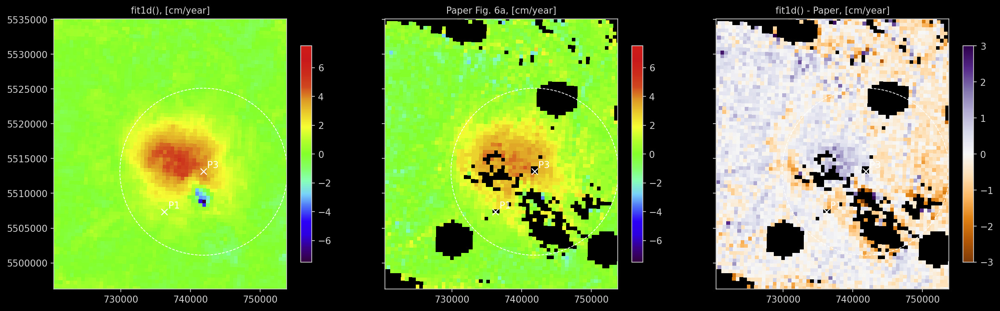

### NISAR

 NISAR L-band FrequencyA/B Split-Spectrum HH Time Series Analysis for Mexico City Subsidence.

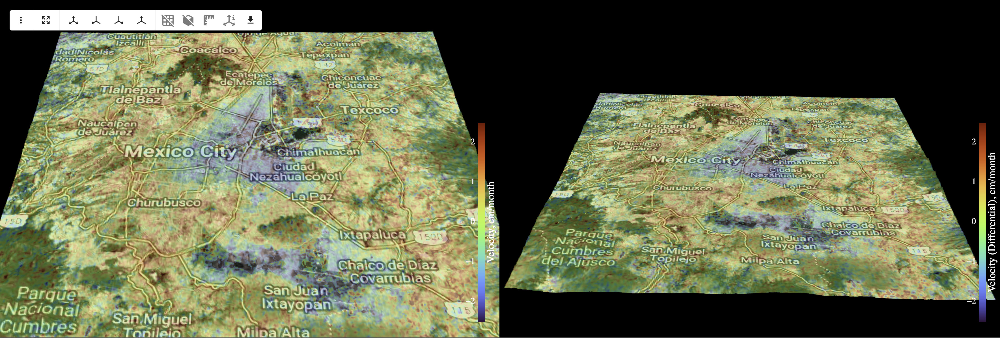

 NISAR L-Band HH/HV RGB composite, HH interferogram, and unwrapped phase.

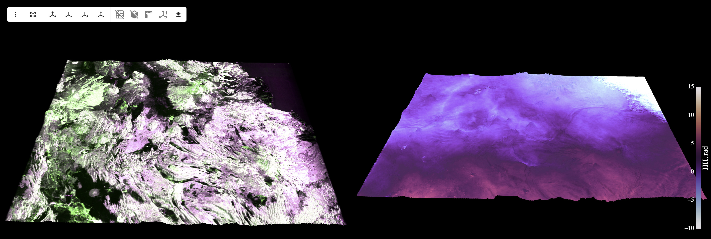

 **Anak Krakatau Eruption, Indonesia (2026).** Animated NISAR L-band frequency B HH/HV RGB composite (R = HH, G = HV, B = HH/HV) of the Krakatau archipelago, seen through the ash plume and clouds of the 4–8 September eruption: nine ascending acquisitions from 26 June to 12 October 2026, with a multi-temporal speckle filter and daily frames interpolated in time (PCHIP). Only a 22 × 22 km crop of each frame is downloaded (0.65 GB for the whole series).

[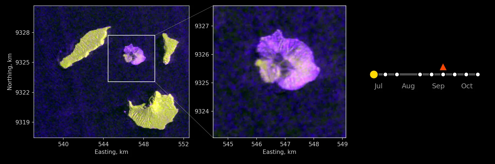](assets/Krakatau_Eruption_2026.mp4)

### Sentinel-1

 **Gastein Valley, Austria (2023–2026).** Persistent and distributed scatterer (PS/DS) line-of-sight velocity around Bad Gastein from 91 Sentinel-1A VV dates (descending path 95, one IW2 burst), geocoded at full resolution on an 8 × 2 m grid. A PS network is solved and DS are attached to it, and the results are exported to GeoPackage. The image shows the LOS velocities of 3 reference areas over a satellite basemap.

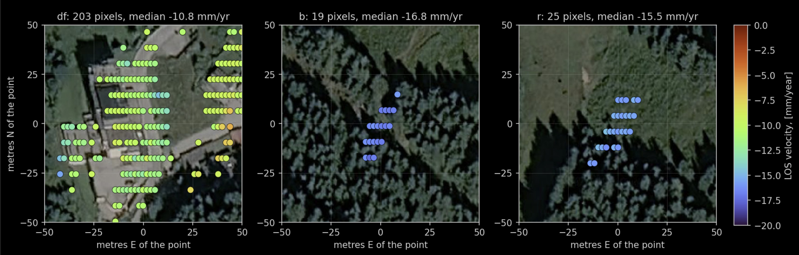

 **Lake Sarez Landslides, Tajikistan (2017).** Line-of-sight (LOS) velocity of the landslides at Lake Sarez in the Pamir Mountains from 19 Sentinel-1A VV dates (descending path 5, two IW2 bursts, May–December 2017), computed directly from the phase of every date with no interferogram pairs and no phase unwrapping: per pixel with `fit1d()` and on a network of persistent and distributed scatterers with `fit1d_network()`. The results are compared to the velocity map, time series and velocity ranges of [Nardini et al. (2024)](https://doi.org/10.1007/s10346-024-02214-y). The image shows both velocity maps in 3D over the satellite basemap draped on the DEM.

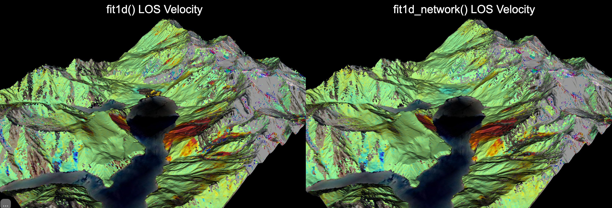

 **Iran–Iraq Earthquake (2017)**. The results compared to outputs from GMTSAR, SNAP, and GAMMA software. Illustrates bursts search by area, date, and attributes.

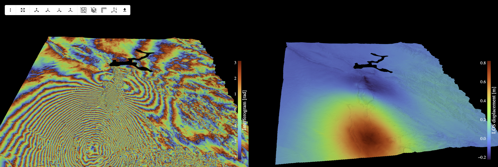

 **Central Türkiye Earthquakes (2023).** Interferogram covering two consecutive Sentinel-1 scenes (56 bursts).

 **La Cumbre Volcano Eruption, Galápagos, Ecuador (2020).** Deformation of Fernandina Island caused by the 12–13 January 2020 fissure eruption, mapped by a single Sentinel-1 descending interferogram (2020-01-10 S1B, 2020-01-16 S1A; eight bursts). The interferogram is unwrapped, converted to line-of-sight (LOS) displacement of tens of centimetres, shown in 3D on the DEM, and compared to the map published by the Instituto Geofísico, Escuela Politécnica Nacional (IG-EPN).

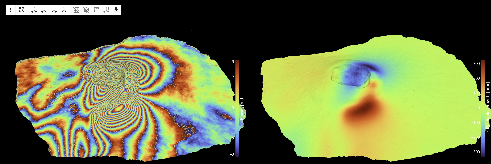

 **Pico do Fogo Volcano Eruption, Cape Verde (2014).** Deformation of Fogo Island caused by the eruption that began on 23 November 2014, mapped by one of the first Sentinel-1 TOPS interferograms of a volcanic eruption (descending pair 2014-11-08, 2014-12-02; two bursts per date). The interferogram is unwrapped, converted to line-of-sight (LOS) displacement, shown in 3D on the DEM, and compared to the interferogram published by [González et al. (2015)](https://doi.org/10.1002/2015GL066003).

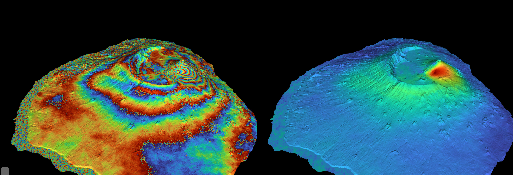

 **Imperial Valley Subsidence, CA USA (2015).** SBAS velocity map from a Sentinel-1 time series stack. Interactive result: [Imperial_Valley_2015.html](https://insar.dev/ui/Imperial_Valley_2015_ipyleaflet.html). Uses the same bursts as the GMTSAR ['Sentinel-1 TOPS Time Series' example](http://topex.ucsd.edu/gmtsar/tar/S1A_Stack_CPGF_T173.tar.gz).

 **Golden Valley Subsidence, CA USA (2021).** SBAS velocity map detecting subsidence exceeding 5 cm/year near Antelope Valley Freeway in Santa Clarita, CA. Reproduces results from the EarthDaily [Sentinel-1 Technical Series](https://earthdaily.com/blog/sentinel-1-targeted-analysis).

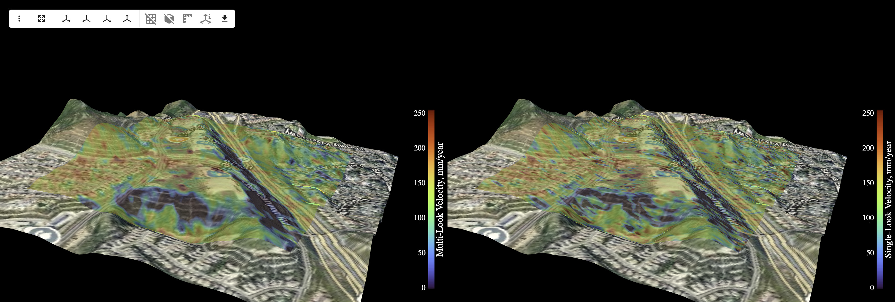

 **Erzincan Elevation, Türkiye (2019).** DEM generation from a single Sentinel-1 interferometric pair. Reproduces the ESA tutorial [DEM generation with Sentinel-1 IW](https://step.esa.int/docs/tutorials/S1TBX%20DEM%20generation%20with%20Sentinel-1%20IW%20Tutorial.pdf).

## InSAR.dev Premium

InSAR.dev Premium modules extend the packages above with the precise ECEF preprocessor, PolSAR phase optimization, advanced per-date atmospheric trends, radiometric calibration, and more. The example notebooks open for everyone on Google Colab; rerunning them requires an active InSAR.dev Premium subscription, see [pechnikov.dev](https://pechnikov.dev).

 **Gastein Valley, Austria (2023–2026).** Persistent and distributed scatterer (PS/DS) line-of-sight velocity from 91 dual-polarization Sentinel-1 dates with PolSAR phase optimization: 7,950 PS and 178,418 DS, down to the power line pylons hidden in vegetation.

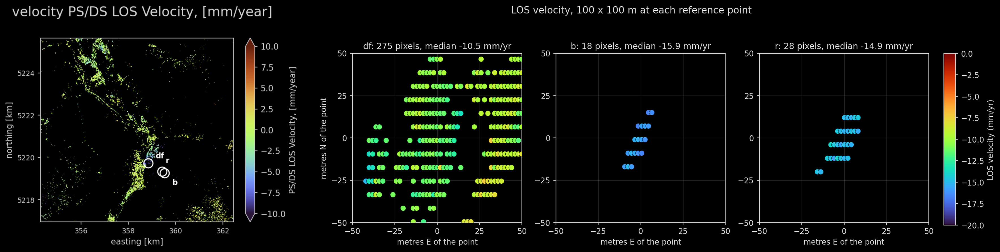

 **Surat Basin, Queensland: Corner Reflectors of FRM4SAR TN-200 (2016).** Reproduces FRM4SAR TN-200 Issue 1.4, Appendix 2 with the precise ECEF preprocessor: 40 trihedral corner reflectors of the Geoscience Australia survey on a Sentinel-1A IW SLC scene, geocoded with and without the ERA5 troposphere and CODE ionosphere, and the residual between each reflector peak and its expected position, with CR11 compared to TN-200 Table 17.

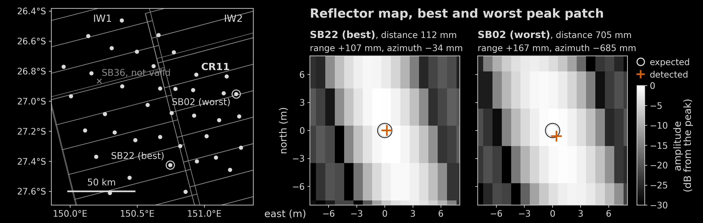

## Contact

- Author: Aleksei (Alexey) Pechnikov
- Website [pechnikov.dev](https://pechnikov.dev)
- Email: alexey@pechnikov.dev
- ORCID: https://orcid.org/0000-0001-9626-8615

## Bug Reports

Bug reports and suggestions are welcome via the project's issue tracker.
